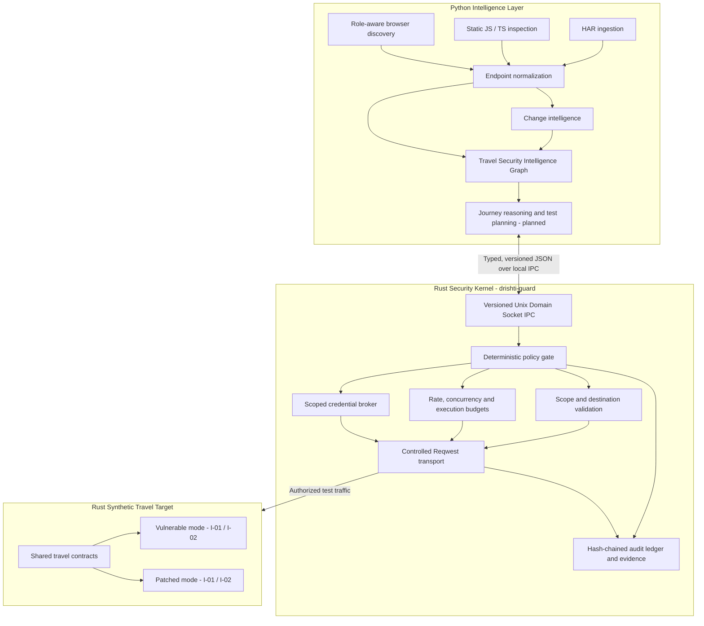

<div align="center">

# ◈ DRISHTI AI

### Agentic, Journey-Aware Security Testing for B2B Travel Platforms

**See the journey. Understand the risk. Prove the vulnerability.**

[](https://www.python.org/)
[](https://www.rust-lang.org/)
[](https://github.com/tokio-rs/axum)
[](LICENSE)
[](https://unstop.com/)
[](#verification-status)

*An application is more than a collection of endpoints. It is a network of identities, bookings, suppliers, payments, and state transitions. Drishti AI tests the rules that hold that network together.*

</div>

---

## The idea

B2B travel platforms coordinate agencies, sub-agencies, airlines, hotel suppliers, quotes, reservation holds, bookings, payments, cancellations, and refunds. Their highest-impact security failures are often **business-logic violations**, not just malformed requests.

Examples include:

- **Cross-tenant access (BOLA/IDOR):** Agency B can read or modify Agency A's booking or passenger data.
- **Pricing integrity failures:** a client-controlled amount, currency, or markup overrides the server-authoritative quote.
- **Reservation-state failures:** an expired hold or invalid transition can still produce a booking.
- **Transaction consistency failures:** retries or concurrent actions can create duplicate financial side effects.
- **Undocumented attack surface:** old or shadow APIs remain reachable outside the expected security inventory.

Traditional endpoint scanners can identify important technical defects, but they often lack the business context required to reason about a multi-step travel journey.

**Drishti AI takes a journey-first, invariant-driven approach.** It builds an evidence-backed model of the application's API surface and business flows, proposes targeted tests, sends active requests through a controlled Rust security kernel, independently verifies candidate findings, and preserves evidence for remediation and retesting.

## What makes Drishti different?

| Capability | What Drishti does |
|---|---|
| **Journey-aware testing** | Connects endpoints to roles, tenants, objects, and travel workflow states. |
| **Invariant-driven probes** | Tests explicit rules such as tenant isolation and server-authoritative pricing. |
| **Evidence-backed discovery** | Reconciles HAR observations, normalized routes, and statically extracted frontend routes. |
| **Deterministic enforcement** | Keeps scope, credentials, budgets, transport, and audit decisions outside the LLM. |
| **Independent verification** | Uses black-box canary checks, negative controls, and three-way outcomes. |
| **Closed-loop remediation** | Preserves a reproducible test recipe for post-fix retesting. |

## Architecture

Drishti uses a **Python intelligence layer + Rust security kernel + Rust travel testbed** architecture.



### Separation of responsibility

- **Python reasons:** parses discovery evidence, interprets journeys, correlates routes, and proposes structured test hypotheses.
- **Rust enforces:** validates the request, applies scope and resource policies, resolves scoped credentials, performs authorized transport, and records evidence.
- **The testbed proves:** runs the same travel API contract in deliberately vulnerable and patched modes so security invariants can be tested differentially.

The LLM is not an unrestricted network client. A proposed test is not permission to execute it. Every active request must pass the Rust policy and transport boundary. OS-level network isolation is part of the deployment security model; a Unix socket by itself is not a substitute for host/container egress controls.

## The first security invariants

The initial vertical slice focuses on two high-value invariants.

### I-01 — Tenant isolation (BOLA / IDOR)

An identity belonging to Agency B must not read or mutate a booking, passenger record, voucher, or invoice owned by Agency A.

**Black-box verification:** Agency A creates a synthetic object containing a unique canary. Agency A's authorized access establishes the baseline. Agency B then attempts the scoped access check. A finding requires evidence that the protected canary was disclosed or an unauthorized state change occurred; an HTTP status alone is not sufficient.

### I-02 — Server-authoritative pricing

Client-controlled amounts, currencies, markups, taxes, or discounts must not override the server-authoritative quote.

**Verification:** compare the original synthetic quote with the server-observable checkout result after a controlled input variation. The mock testbed does not perform real payment settlement.

### Additional invariants on the roadmap

- I-03 — Reservation hold expiry and valid state transitions.
- I-04 — Payment callback and retry idempotency.
- I-05 — Cancellation and refund bounds.
- I-06 — Sub-agent privilege boundaries.
- I-07 — Supplier identity and callback isolation.
- I-08 — Error hygiene and sensitive-data exposure.

The reservation model takes inspiration from the engineering pressures of high-demand systems such as railway and airline booking: scarce inventory, expiring holds, concurrency, and transaction consistency.

## Discovery pipeline

The current offline discovery subsystem combines several evidence sources:

| Source | Current capability | Evidence produced |
|---|---|---|
| **HAR 1.1 / 1.2** | Bounded, offline archive ingestion; sensitive-data redaction; request canonicalization | Sanitized request observations and provenance |
| **Endpoint normalizer** | Static-route preservation, dynamic identifier recognition, namespaced clustering | Canonical endpoint identities and parameter candidates |
| **JavaScript / TypeScript bundles** | Static extraction of common `fetch` and Axios patterns, route templates, parameter candidates, and source locations | Frontend route observations and source provenance |
| **Change detector** | Versioned attack-surface change sets, parameter additions, method mutations, and differential delta tracking | Versioned attack-surface change sets and recommended invariants |
| **Playwright crawler** | Role-specific journeys, multi-tenant browser context isolation, and fail-closed NetworkBridge mediation | Role-specific journeys, browser traffic observations, and sanitized HAR |

Discovery outputs are observations, not automatic proof that an endpoint is active, vulnerable, or authorized. Static bundle references and captured traffic are kept distinguishable by provenance.

## Security by design

The security kernel is designed around explicit, auditable controls:

- **Default-deny authorization contract:** only configured targets, ports, schemes, methods, and actions are eligible.
- **Destination validation:** DNS and resolved-address checks, redirect revalidation, and destination pinning.
- **Configurable execution budgets:** token-bucket limits, burst capacity, concurrency, per-test and global budgets, and timeouts are configuration-driven.
- **Circuit breaker:** execution pauses when target-health policy is breached.
- **Scoped credentials:** secrets are resolved by the trusted Rust component and are not included in LLM context or ordinary logs.
- **Controlled transport:** redirects are handled explicitly and revalidated before another request is sent.
- **Audit-before-send:** the request intent is recorded before active transmission.
- **Tamper-evident ledger:** canonical serialization, SHA-256 hash chaining, and signed checkpoints make unauthorized ledger changes detectable.
- **Evidence minimization:** sensitive headers, cookies, tokens, and personal data are redacted before persistence.
- **Emergency stop and human approval:** elevated operations can require approval; global stop is separate from a per-request denial.

> **Operating rule:** the model proposes; deterministic policy decides; controlled transport executes; independent verification establishes the result.

## Current implementation status

Status below reflects the latest development milestone reported by the project team. It is not a claim of production deployment or independent third-party certification.

| Workstream | Status | Notes |
|---|---|---|
| Python secure execution foundation | **Complete** | Policy, budgets, credential broker, evidence redaction, audit ledger, and tests |
| Python deterministic travel target | **Complete** | Shared travel simulator with vulnerable and patched I-01 / I-02 implementations |
| Rust shared domain contracts | **Complete** | Typed models, money types, serialization tests, and generated schemas |
| Rust Axum travel target | **Complete** | Shared API contract, vulnerable/patched modes, differential tests |
| Rust security kernel | **Implemented** | Policy gate, scope validation, budgets, credentials, controlled transport, audit, and UDS IPC |
| HAR ingestion and endpoint normalization | **Complete** | Bounded offline ingestion, redaction, provenance, canonical digests |
| Static frontend bundle inspection | **Complete** | Common `fetch` / Axios patterns, route candidates, source locations, and reconciliation with normalized endpoints |
| Change detection | **Complete** | Compare versioned inventory, HAR, bundle, schema, and deployment evidence |
| Role-aware Playwright discovery | **Complete** | Isolated multi-tenant browser contexts with fail-closed NetworkBridge mediation |
| Travel Security Intelligence Graph | **Complete** | NetworkX MultiDiGraph, typed schema, independent Quote/Hold/Booking/Payment/Refund lifecycles, and invariant binding |
| Specialist executors and full finding lifecycle | **In progress** | I-01 Tenant Isolation BOLAExecutor implemented with 5-step guarded verification against vulnerable and patched travel targets |

## Repository layout

```text
drishti-ai/
├── configs/
│   ├── auth_contract.json
│   ├── test_profiles.json
│   └── test_budgets.yaml
│
├── drishti/                         # Python intelligence and discovery
│   ├── core/
│   ├── policy/                      # Python reference / integration controls
│   ├── audit/                       # Python reference implementation
│   ├── discovery/                   # HAR, AST bundle, normalizer, change detector, crawler
│   │   ├── models.py
│   │   ├── endpoint_normalizer.py
│   │   ├── har_parser.py
│   │   ├── bundle_inspector.py
│   │   ├── change_detector.py
│   │   ├── crawler.py
│   │   └── network_bridge.py
│   └── graph/                       # Travel Security Intelligence Graph
│       ├── schema.py                # Typed nodes, edges, fact classifications
│       ├── state_machine.py         # Independent entity lifecycles & transition rules
│       └── engine.py                # NetworkX MultiDiGraph, invariant binding, attack paths
│
├── rust/
│   ├── Cargo.toml
│   ├── Cargo.lock
│   ├── schemas/
│   └── crates/
│       ├── drishti-core/
│       ├── drishti-guard/
│       └── mock-travel-api/
│
├── tests/
│   ├── fixtures/
│   ├── test_scope_validation.py
│   ├── test_audit_integrity.py
│   ├── test_har_parser.py
│   ├── test_bundle_inspector.py
│   ├── test_change_detector.py
│   ├── test_crawler.py
│   ├── test_graph_schema_state_machine.py
│   ├── test_travel_security_graph.py
│   └── ...
│
├── docs/
│   └── architecture/
│
├── pyproject.toml
└── README.md
```

## Development setup

### Prerequisites

- Python 3.11 or newer
- Rust stable toolchain and Cargo
- Git
- Linux is recommended for the Unix Domain Socket and process/network isolation work
- Playwright browser dependencies are needed when browser crawling is enabled

### Clone the repository

```bash
git clone https://github.com/Rajatjyoti-arch/drishti-ai.git
cd drishti-ai
```

### Python environment

```bash
python3 -m venv .venv
source .venv/bin/activate
python -m pip install --upgrade pip
pip install -e ".[dev]"
```

### Rust workspace

```bash
cargo check --workspace
cargo test --workspace
```

### Python tests

```bash
pytest -v tests/
```

### Validate the authorization contract

```bash
python -m drishti.main verify-contract \
  --contract-path configs/auth_contract.json
```

> Active testing must remain disabled until the target, accounts, allowed operations, and execution budgets are explicitly authorized and configured. Use the synthetic vulnerable/patched travel target for local development. Never place real bearer tokens or customer data in configuration files, prompts, screenshots, or commits.

## Verification status

Latest reported automated test results:

| Suite | Reported result |
|---|---:|
| Rust workspace | 40 passed |
| Python suite | 166 passed |
| **Combined** | **206 passed** |

Run the commands above to reproduce the results in your own checkout. Test counts are a snapshot of the reported milestone and may change as the suite grows.

## Engineering roadmap

- [x] **Foundation:** Python policy, audit, credentials, budgets, and safe-client reference implementation.
- [x] **Synthetic target:** B2B travel simulator with vulnerable and patched I-01 / I-02 modes.
- [x] **Rust foundation:** `drishti-core`, Axum mock target, and standalone `drishti-guard` daemon.
- [x] **Offline discovery:** HAR ingestion, endpoint normalization, and static frontend bundle inspection.
- [x] **Change intelligence:** versioned inventory and schema reconciliation; identify security-relevant changes.
- [x] **Role-aware crawling:** Playwright discovery with guard-mediated network access.
- [x] **Travel Security Intelligence Graph:** model tenants, identities, endpoints, objects, journeys, independent lifecycles, and invariants.
- [ ] **Specialist testing:** complete I-01 and I-02 test adapters against the authorized staging target.
- [ ] **Finding lifecycle:** independent black-box verification, actionable reports, and post-fix retesting.
- [ ] **Extended coverage:** reservation concurrency, payment idempotency, zombie/shadow API inventory, and additional invariants.

## Project principles

1. **Proof over payload volume.** A finding needs an invariant, evidence, and a reproducible verification path.
2. **Context over isolated URLs.** Roles, tenants, objects, and workflow state matter.
3. **Deterministic enforcement over model trust.** LLM output never grants itself execution authority.
4. **Honest measurement over absolute claims.** Precision, coverage, latency, and test limitations must be measured and disclosed.
5. **Safety before autonomy.** Scope, credentials, request budgets, audit, and stop controls govern every active test.

## License

This project is licensed under the [Apache License 2.0](LICENSE).

---

<div align="center">

**DRISHTI AI**  
*See the journey. Understand the risk. Prove the vulnerability.*

Built for the security challenges of modern B2B travel ecosystems.

</div>
