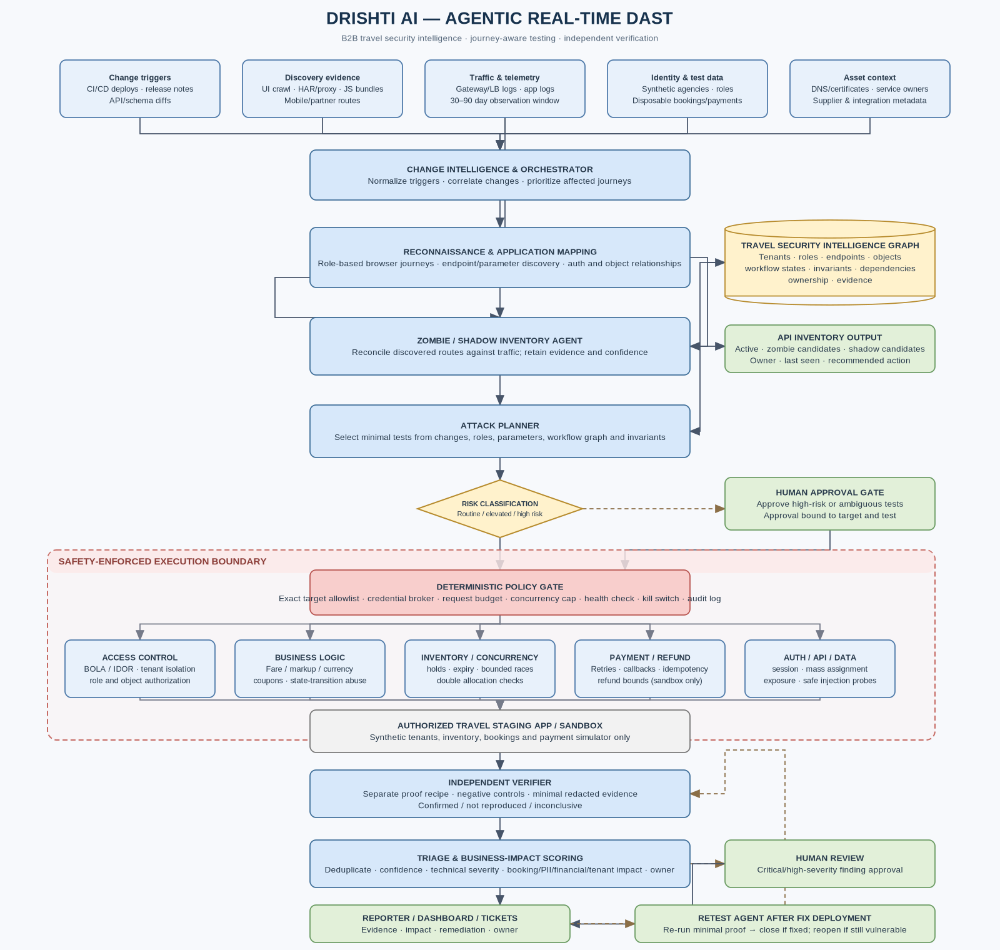

# Drishti AI: Agentic Real-Time DAST for B2B Travel Ecosystems

[](LICENSE)
[](https://www.python.org/)
[](https://unstop.com)
[](#)

> *"See the journey. Understand the risk. Prove the vulnerability."*

**Drishti AI** is an autonomous, journey-aware Dynamic Application Security Testing (DAST) platform engineered specifically for the transactional and multi-tenant complexities of B2B travel ecosystems like **TBO.com**.

---

## 🏗️ Architecture Overview

Rather than analyzing disconnected HTTP endpoints, Drishti AI models the complete travel state machine and enforces platform invariants across continuous deployments.



---

## 📌 The Problem in B2B Travel Technology

B2B travel platforms connect airlines, hotel aggregators, and tour suppliers with thousands of travel agencies and sub-agencies. Daily deployments introduce subtle business-logic flaws that traditional, scheduled DAST tools completely miss:

1. **Multi-Tenant Boundary Failures (BOLA / IDOR):** One travel agency accessing, altering, or canceling bookings and passenger PII belonging to another agency.
2. **Checkout Tariff & Markup Tampering:** Modifying client-side price, currency codes, or markup parameters during the transition between reservation `Hold` and `Confirm`.
3. **Concurrent Double-Refund Abuse:** Parallel cancellation requests triggering duplicate refunds before database locks acquire.
4. **Zombie & Shadow APIs:** Deprecated `/v1/` routes or unmapped partner webhooks remaining active without modern authentication or rate limiting.

---

## 🛡️ The Four Architectural Mandates

Drishti AI is built on four non-negotiable architectural mandates:

### 1. Machine-Enforced Authorization Contract & Configurable Budgets
All testing is strictly bounded by a signed, machine-readable contract (`configs/auth_contract.json`) and authoritative execution budgets (`configs/test_budgets.yaml`). The Policy Gate deterministically enforces:
* Configurable token-bucket rate limits and concurrency semaphores.
* Per-test request ceilings and global session budgets (retries consume from the same budget).
* Automated circuit breakers tripping on latency spikes or consecutive 5xx errors.
* Strict prohibition on destructive actions (no `DROP`, no DoS, no raw shell commands).

### 2. Evidence-Backed LLM Provenance
The LLM *proposes*; deterministic code *decides*. Every inferred endpoint, role permission, and parameter semantic must carry cryptographic provenance anchoring it to an observed raw network request (HAR frame ID + SHA-256 packet hash + confidence score). Hallucinations are rejected at ingestion.

### 3. Black-Box Invariant Verification (Zero Database Assumptions)
Drishti AI requires zero internal database access. Invariant verification is conducted black-box:
* **Legitimate Baseline:** An authorized Agency A session creates a synthetic booking containing an injected unique canary.
* **Cross-Tenant Probe:** An authenticated Agency B session attempts to access that object reference.
* **Invariant Oracle:** A violation is confirmed **if and only if** Agency B observes Agency A's protected canary or mutates its state, while Agency A retains authorized access.

### 4. Strict Reproducibility & Invariant Restoration
Every confirmed finding includes:
* The exact ordered state-setup request sequence.
* A self-contained, copy-pasteable cURL command with sanitized test tokens.
* Cryptographic request/response evidence digests stored in a tamper-evident hash-chained ledger.
* An automated retest recipe that verifies the **security invariant is restored** post-remediation, regardless of whether the server responds with 403, 404, or authorized empty data.

### 5. Hybrid Architecture: Rust Security Kernel + Python Intelligence
To achieve mathematically unbypassable security and zero-overhead crypto performance, Drishti AI implements a hybrid execution boundary:
* **Rust Security Kernel (`drishti-guard` & `drishti-core`):** Owns physical network sockets, OS-level process isolation, non-reusable bound authorization decisions, sub-millisecond SHA-256 hash chaining, and credential isolation.
* **Python Intelligence Layer:** Owns LLM hypothesis generation (LangGraph), Playwright browser crawling (official SDK), HAR traffic decomposition, and NetworkX travel state machines.
* **Axum Synthetic Travel Target (`mock-travel-api`):** Shared Rust domain contracts running both Vulnerable (seeded I-01/I-02 flaws) and Patched modes for high-speed differential testing.

---

## ⚡ The Frozen 7-Step Single Loop (Milestone 1)

All active engineering is frozen around delivering **one complete, reproducible security finding** against an authorized staging target:

```
[Target Change Ingested]
           │
           ▼
1. Detect Change ──────────────► Webhook, commit SHA, or HAR bundle diff
           │
           ▼
2. Discover Endpoints ─────────► Playwright crawl (with BrowserGuard) + provenance inference
           │
           ▼
3. Identify Invariant Candidate ► Match against I-01 (BOLA) or I-02 (Pricing Tampering)
           │
           ▼
4. Execute Authorized Test ────► Deterministic Policy Gate enforces allowlist & budgets
           │
           ▼
5. Independent Verification ───► Black-box canary oracle + negative controls
           │
           ▼
6. Synthesize Report ──────────► Self-contained cURL PoC, response diff, code patch
           │
           ▼
7. Retest After Patch ─────────► Automated re-run verifies security invariant is restored
```

---

## 📊 P0 Feasibility Matrix

| Module / Component | P0 Functional Scope | Technical Dependencies | Potential Failure Modes | Mitigation & Fallback Strategy |
| :--- | :--- | :--- | :--- | :--- |
| **Change Ingestion** | Ingest commit webhook, endpoint diff, or static HAR bundle. | Python 3.11+, Git diff parser, JSON Schema. | Missing/malformed webhook payloads; schema drifts. | Fallback to manual directory/HAR file watcher with standard schema validator. |
| **Recon & Crawl** | Extract authenticated routes across 2 agency roles via browser. | Playwright (Chromium), mitmproxy / HAR parser. | Anti-bot mechanisms, SPA hydration delays, dynamic element selectors. | BrowserGuard intercepts traffic; pre-recorded authenticated session tokens. |
| **Endpoint Inference** | Infer endpoint path, parameters, roles, and journey position. | LLM (Claude 3.5 Sonnet / GPT-4o) + Pydantic v2. | Hallucinated routes, fabricated parameter types, missing auth headers. | **Strict Provenance Gate:** Every route must anchor to a real HAR request ID with SHA-256 hash. |
| **Policy Gate & Safety** | Deterministic enforcement of domain allowlist, rate limits, budgets. | Token-bucket algorithm, Python standard library. | Misconfigured regex matching out-of-scope hosts; rate limit bursts. | Default-deny CIDR & host regex; configurable concurrency ceiling; immediate kill switch. |
| **Specialist Executor** | Execute BOLA (I-01) and Tariff Tampering (I-02) probes. | SafeHttpClient, isolated CredentialBroker. | Staging environment 500 errors; session token expiration during test. | Scoped credential broker; exponential backoff on latency spikes; circuit breaker. |
| **Independent Verifier** | Reproduce candidate findings using clean fixtures & negative controls. | Isolated test runner, JSON path evaluator. | Flaky network false positives; verifier bias inheriting planner assumptions. | Strict separation: Canary-based invariant oracle and negative control verification. |
| **Retest Engine** | Re-run minimal proof against updated commit SHA; verify remediation. | Git webhook listener, test runner. | Premature ticket closure due to partial fixes or caching. | Invariant assertion: Ticket closes **only** if invariant is restored and negative control passes. |

---

## 📁 Repository Structure

```
drishti-ai/
├── README.md                           # Master architectural guide and setup instructions
├── pyproject.toml                      # Python 3.11+ packaging, dependencies, and lint configs
├── configs/
│   ├── auth_contract.json              # Active authorization contract (domains, accounts, limits)
│   ├── test_profiles.json              # Synthetic tenant profiles (Agency A, Agency B, Sub-Agent)
│   └── test_budgets.yaml               # Authoritative execution & safety budgets (configurable)
├── docs/
│   ├── architecture/                   # Architecture diagrams (.png, .svg, and editable .drawio)
│   ├── DRISHTI_AI_MASTER_PLAN.md       # Comprehensive system master plan
│   └── DRISHTI_AI_IMPLEMENTATION_SPEC.md # Detailed engineering and module specification
├── drishti/
│   ├── __init__.py
│   ├── main.py                         # Single-loop CLI entrypoint
│   ├── core/                           # Configuration, exceptions, and Pydantic data schemas
│   │   ├── config.py                   # Typed ExecutionBudgets loader
│   │   ├── contract.py                 # Authorization Contract model
│   │   ├── models.py                   # Structured schemas (PolicyAction, OutgoingTestRequest)
│   │   └── exceptions.py               # PolicyViolationError, OutOfScopeError, EmergencyStopTriggered
│   ├── policy/                         # Deterministic Policy Gate & Safety Boundaries
│   │   ├── scope_validator.py          # FQDN, port, scheme, and DNS destination resolver
│   │   ├── egress_guard.py             # Network egress boundaries & 3xx redirect re-validation
│   │   ├── rate_limiter.py             # MultiBudgetRateLimiter (token-bucket, concurrency, budgets)
│   │   ├── health_monitor.py           # Target latency monitor & automated circuit breaker
│   │   ├── credential_broker.py        # Scoped secrets broker isolating tokens from LLM/logs
│   │   ├── approval_manager.py         # Human approval gate for elevated/high-risk test actions
│   │   ├── browser_guard.py            # Playwright route interceptor aborting out-of-scope traffic
│   │   ├── gate.py                     # Central deterministic Policy Gate orchestrating all boundaries
│   │   └── client.py                   # SafeHttpClient (the ONLY approved network transport interface)
│   ├── audit/                          # Tamper-Evident Hash-Chained Audit Ledger
│   │   ├── hash_chain.py               # Canonical JSON serialization & SHA-256 hash chaining
│   │   ├── ledger_verifier.py          # Cryptographic chain verifier detecting tampering/reordering
│   │   ├── evidence_store.py           # Sanitized evidence storage with automated PII redaction
│   │   └── ledger.py                   # Append-only SQLite ledger with signed checkpoints
│   ├── discovery/                      # API Discovery & Route Normalization Engine
│   │   ├── models.py                   # NormalizedEndpoint, ParameterCandidate, EndpointObservation
│   │   ├── endpoint_normalizer.py      # Deterministic clustering, static keyword preservation, UUIDv4 detection
│   │   └── har_parser.py               # Offline HAR 1.2 ingestion, canonical request digest, security redaction
│   └── ipc/                            # Process-Isolated Unix Domain Socket Client Bridge
│       └── client.py                   # RustGuardClient forwarding requests over /run/drishti/guard.sock
├── tests/
│   ├── fixtures/                       # Deterministic B2B Travel Simulator & Test Personas
│   │   ├── mock_travel_api.py          # Base travel simulator (search, quotes, holds, bookings, canaries)
│   │   ├── vulnerable_app.py           # Seeded BOLA (I-01) & pricing tampering (I-02) flaws
│   │   └── patched_app.py              # Tenant-isolated & server-authoritative pricing implementation
│   ├── test_scope_validation.py        # 5 tests: scheme, port, host allowlist, redirect safety
│   ├── test_audit_integrity.py         # 5 tests: chain validation, payload modification, deletion
│   ├── test_policy_bypass.py           # 6 tests: destructive payloads, budget caps, circuit breaker
│   ├── test_credential_isolation.py    # 2 tests: secret masking, expiration, target-binding
│   ├── test_evidence_redaction.py      # 2 tests: automated PII/token scrubbing, payload limits
│   ├── test_approval_manager.py        # 2 tests: human approval lifecycle, risk thresholds
│   ├── test_concurrency_budgets.py     # 2 tests: parallel worker budget contention, semaphores
│   ├── test_decision_binding.py        # 2 tests: cryptographic decision nonce binding, replay rejection
│   ├── test_stage2_fixtures.py         # 6 tests: differential verification of I-01 and I-02
│   ├── test_fixture_reset.py           # 2 tests: environment reset isolation and state independence
│   ├── test_rust_ipc_integration.py    # 3 tests: Python UDS client protocol, versioning, error propagation
│   ├── test_endpoint_normalizer.py     # 11 tests: static keyword preservation, UUIDv4, wildcard redaction
│   └── test_har_parser.py              # 9 tests: offline HAR 1.2 ingestion, digest reproducibility, safety limits
└── rust/                               # Rust Security Kernel & High-Performance Services
    ├── Cargo.toml                      # Cargo workspace root
    ├── schemas/                        # 9 Canonical JSON Schemas generated from Rust types
    └── crates/
        ├── drishti-core/               # Shared domain contracts, Serde models, JSON Schema (16 tests)
        ├── drishti-guard/              # Native security kernel daemon, UDS IPC, SQLite ledger (21 tests)
        └── mock-travel-api/            # Axum B2B travel simulator with vulnerable & patched modes (3 tests)
```

---

## 🚀 Quickstart & Setup

### Prerequisites
* Python 3.11 or newer
* Node.js & Playwright (for headless browser recon)

### Installation
```bash
# Clone the repository
git clone https://github.com/Rajatjyoti-arch/drishti-ai.git
cd drishti-ai

# Create and activate virtual environment
python3 -m venv .venv
source .venv/bin/activate

# Install dependencies
pip install -e ".[dev]"

# Run Stage 1 security test suite
pytest -v tests/
```

### Validate Authorization Contract
```bash
python3 -m drishti.main verify-contract --contract-path configs/auth_contract.json
```

---

## 🗓️ Engineering Roadmap

* [x] **Stage 1: Secure Execution Foundation:** Tamper-evident ledger, ScopeValidator with DNS checks, MultiBudgetRateLimiter, CredentialBroker, BrowserGuard, and SafeHttpClient. *(Frozen at git tag `stage1-python-reference`, 34 passing tests).*
* [x] **Stage 2: Deterministic Travel Target:** Common travel simulator (`mock_travel_api.py`), seeded BOLA (`vulnerable_app.py`), and authoritative pricing (`patched_app.py`).
* [x] **Rust Phase 1: Shared Domain Contracts (`drishti-core`):** Strong typing, Serde models, Schemars JSON Schema generation, and golden serialization compatibility tests. *(16 passing tests).*
* [x] **Rust Phase 2: High-Performance Travel Simulator (`mock-travel-api`):** Axum target running both vulnerable and patched services on identical domain models. *(3 differential tests).*
* [x] **Rust Phase 3: Native Security Kernel (`drishti-guard`):** Rusqlite single-writer ledger, SHA-256 hash chaining, token-bucket limiter, Reqwest transport, Unix socket IPC. *(21 passing tests).*
* [x] **Stage 3: Discovery & Normalization:** Deterministic endpoint normalization, static alternative branch preservation, UUIDv4 pattern recognition, wildcard query redaction, and offline HAR 1.2 parser with canonical digest computation. *(20 passing tests: 11 normalizer tests + 9 HAR parser tests).*
* [ ] **Stage 4: Travel Intelligence Graph:** NetworkX model of `Search ➔ Quote ➔ Hold ➔ Book` and multi-tenant invariant bindings.
* [ ] **Stage 5: Specialist Executors:** Implement `BOLAExecutor` (I-01) and `PricingExecutor` (I-02) dispatching through the Policy Gate.
* [ ] **Stage 6: Black-Box Independent Verifier:** Canary data detection, ownership validation, and invariant oracles.
* [ ] **Stage 7: Retest Engine & Acceptance:** End-to-end change-to-finding-to-fix-to-retest demonstration against staging sandbox.

---

## 📄 License

This project is licensed under the Apache 2.0 License - see the [LICENSE](LICENSE) file for details.
